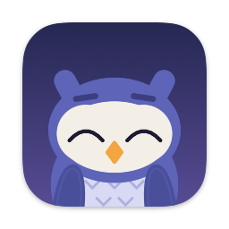
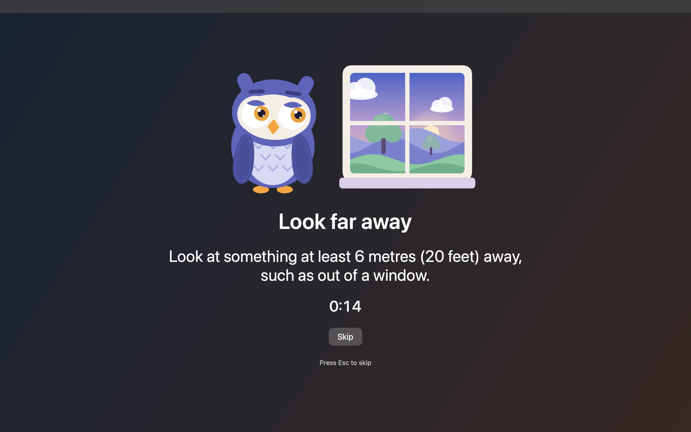

<p align="center">
  
</p>

<h1 align="center">Gazeling</h1>

<p align="center">Short eye breaks for people who live at their screens.</p>

Gazeling is a free macOS menu bar app. Every 20 minutes it dims your screens for a short break, and an owl shows an eye exercise: blink fully, look far away, move your eyes, or rest them. Every hour it reminds you to stand up and walk. A voice reads each exercise out loud, so you can look away from the screen while you do it.



## Features

- Short breaks (every 20 minutes, 20 seconds) and long breaks (every hour, 5 minutes). Both can be changed.
- Nine exercises, each animated by the owl and read out loud. Turn off any you don't want.
- A heads-up notification before each break, with postpone and skip in the menu.
- Pause for a while, or until you resume.
- Works with several screens: all dim, and the owl appears on the one you choose.
- Time away from the computer counts as a break.
- No account, no tracking, no network access.

## Download

Gazeling needs macOS 15 (Sequoia) or later.

Download the zip from the [latest release](https://github.com/danielabar/gazeling/releases/latest), unzip it and move `Gazeling.app` to Applications. The app is not signed with a paid Apple Developer account, so macOS blocks the first launch; the [user guide](docs/user-guide.md#the-first-time-you-open-it) shows how to open it.

## Documentation

- [User guide](docs/user-guide.md): install, breaks, the menu and every setting.
- [Changelog](CHANGELOG.md): what changed in each version.
- [Development](docs/development.md): build, test and run from source.
- [Architecture](docs/architecture.md): how the app is built and why.
- [Releasing](docs/releasing.md): how a new version is published.

## Build from source

Needs Xcode and [XcodeGen](https://github.com/yonaskolb/XcodeGen) (`brew install xcodegen`).

```sh
make test   # unit tests
make run    # build and launch
make help   # all commands
```

## Credits

- The owl, its animations and the chimes were made for Gazeling, in code.
- Voice: [Kokoro](https://huggingface.co/hexgrad/Kokoro-82M) (Apache 2.0), run with [kokoro-onnx](https://github.com/thewh1teagle/kokoro-onnx) (MIT).

Gazeling is not a medical device.

## Licence

[MIT](LICENSE)
