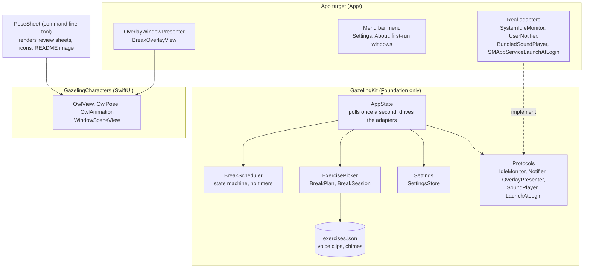
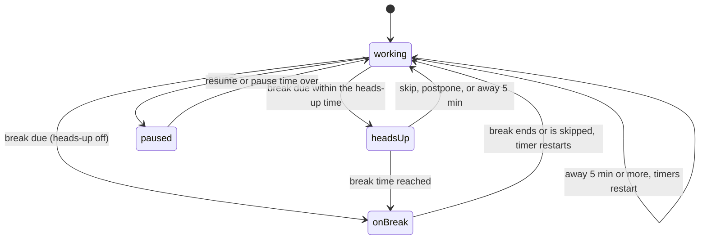
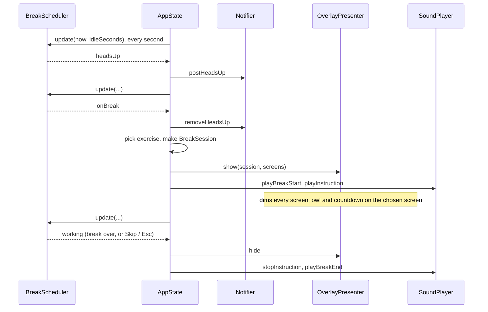

# Architecture

Gazeling is a macOS menu bar app in Swift. The rules (when breaks happen, which exercise, settings) are plain Swift with no user interface code, so they can be unit tested. Everything that talks to macOS sits behind a protocol, with the real implementation in the app and a fake one in the tests.

## Modules

- **App target** (`App/`): SwiftUI for the menu, windows and break content; AppKit for the overlay windows, which must cover every screen and full-screen apps.
- **GazelingKit** (`Packages/GazelingKit/Sources/GazelingKit`): the domain. `AppState` is the one object the user interface observes.
- **GazelingCharacters**: the owl, drawn in code from separate parts, and its animations as pure functions of time.
- **PoseSheet**: a developer tool that renders the owl to PNG files (`make pose-sheet`, `make icons`).
- `project.yml` is the source of the Xcode project; XcodeGen generates `Gazeling.xcodeproj`.

## Break states

`BreakScheduler` holds the state. `AppState` calls `update(now:idleSeconds:)` once a second, compares the old and new state, and shows or hides the notification and overlay.

- A short break restarts the short timer. A long break restarts both timers, and replaces a short break due shortly before it.
- If the Mac sleeps, the gap counts as time away. Waking up never starts a break.

## A break from start to end

## Where data is stored

- **Settings**: `UserDefaults`, as one JSON value (`UserDefaultsSettingsStore`). Unknown or missing keys fall back to defaults, so a new version never wipes saved settings.
- **Exercises**: `exercises.json` in GazelingKit's resources, with localization keys. The text is in `App/Resources/Localizable.xcstrings`.
- **Audio**: voice clips and chimes in GazelingKit's resources, generated by `scripts/generate-audio.sh`.
- The app runs in the App Sandbox and has no network access.
