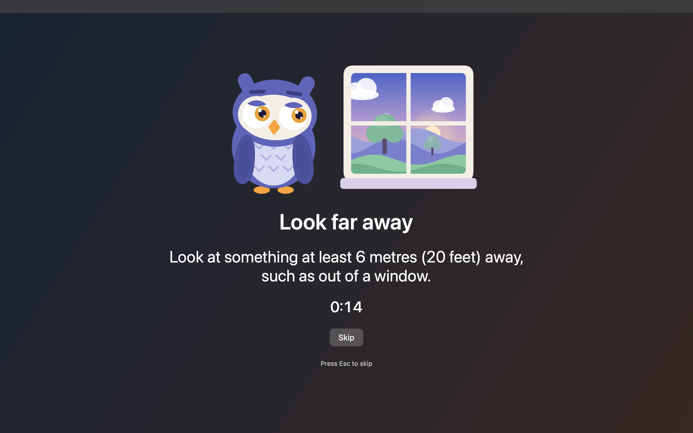

# Gazeling user guide

Gazeling lives in your menu bar and reminds you to rest your eyes. When a break starts, it dims your screens and an owl shows a short eye exercise. A voice reads the exercise out loud, so you can look away from the screen.

## Install

Gazeling needs macOS 15 (Sequoia) or later.

1. Download `Gazeling-<version>.zip` from the [latest release](https://github.com/danielabar/gazeling/releases/latest).
2. Double-click the zip to unzip it.
3. Drag `Gazeling.app` into your Applications folder.
4. Open it from Applications.

### The first time you open it

Gazeling is free and not signed with a paid Apple Developer account, so macOS cannot check it and blocks the first launch. You will see a message like "Apple could not verify 'Gazeling' is free of malware". To open it anyway:

1. Click **Done** in that message.
2. Open **System Settings → Privacy & Security**.
3. Scroll down to the message about Gazeling and click **Open Anyway**.
4. Confirm with your password or Touch ID, then click **Open**.

You only need to do this once per version.

### First-run setup

The first time Gazeling runs, a setup window asks for two things:

- **Notifications.** Gazeling shows a heads-up notification shortly before each break, so a break never starts by surprise. Click **Allow notifications**. If you said no earlier, macOS only lets you change it in System Settings; the window has a button that opens the right page.
- **Start Gazeling when I log in.** Recommended, so you do not have to remember to start it.

You can change both later in Settings.

## How breaks work

- **Short break:** every 20 minutes, for 20 seconds. Each one shows one eye exercise. The exercises take turns.
- **Long break:** every hour, for 5 minutes. Stand up and walk around.
- **Heads-up:** a notification appears 30 seconds before a break.
- **During a break** every screen dims and the owl shows the exercise, its instructions and a countdown. Short breaks give you 5 seconds to read the instruction before the countdown starts. A chime plays at the start and the end.
- **To skip a break,** click **Skip** or press **Esc**.
- **Screens without the owl** let clicks through, so you can still pause a video there.
- **Time away counts as a break.** If you leave the computer for 5 minutes or more (or it sleeps), the timers start again from zero when you come back. Reading or watching without touching the keyboard or mouse does not count: your eyes are still on the screen.

All of these times can be changed in Settings.

### The exercises

| Exercise | What to do |
|---|---|
| Full blinks | Blink slowly and fully, with a gentle squeeze each time. |
| Look far away | Look at something at least 6 metres (20 feet) away, such as out of a window. |
| Eyes side to side | Keep your head still. Look slowly to the far left, then the far right. |
| Eyes up and down | Keep your head still. Look slowly up, then down. |
| Eye circles, left | Keep your head still. Slowly trace a big circle with your eyes, counter-clockwise. |
| Eye circles, right | Keep your head still. Slowly trace a big circle with your eyes, clockwise. |
| Palming | Rub your palms together to warm them. Cup them gently over your closed eyes, without pressing. |
| Close your eyes | Rest with your eyes gently closed. |
| Stand up and walk (long break) | Stand up, stretch and walk around. |

## The menu

Click the owl eyes in the menu bar.

- **Next break at …** shows when the next break starts (or "Paused" or "On a break").
- **Skip next break** skips the coming break and starts its timer again.
- **Pause** stops breaks for 30 minutes, 1 hour, 2 hours or until you resume. **Resume** appears while paused.
- **During the heads-up**, the menu offers **Postpone** (5 minutes by default) and **Skip this break**.
- **About Gazeling** shows the version, why eye breaks help, sources and credits.
- **Settings…** (⌘,) and **Quit Gazeling** (⌘Q).

## Settings

### General

- **Start Gazeling when I log in.**
- **Show the owl on:** where the owl and exercise appear. Every screen dims either way.
  - *The screen with my pointer* (default).
  - *The screen with the menu bar.*
  - *The laptop screen:* the Mac's built-in screen. If the lid is closed, the screen with the menu bar.
  - *Every screen.* With this choice no screen lets clicks through.
- **Play a sound when a break starts and ends.**
- **Read the exercise out loud.** Only available while sounds are on.

### Breaks

- **Short break:** how often (1 minute to 2 hours) and how long (10 seconds to 2 minutes).
- **Long break:** on or off, how often (5 minutes to 4 hours) and how long (1 to 30 minutes).
- **Heads-up:** how long before a break the notification appears (0 to 2 minutes; 0 turns it off), and how long **Postpone** waits (1 to 30 minutes).
- **Restore default timings** puts all of these back.

### Exercises

Switch off any exercise you don't want. You cannot switch off the last one: to stop breaks, use **Pause** in the menu.

## Uninstall

1. Open **Settings → General** and switch off **Start Gazeling when I log in**.
2. Quit Gazeling from its menu.
3. Drag `Gazeling.app` from Applications to the Trash.
4. Optional: to remove your settings too, delete the folder `~/Library/Containers/com.danielabar.gazeling`. (In Finder, press ⇧⌘G and paste that path.)

## Questions and problems

Report a problem or ask a question on [GitHub Issues](https://github.com/danielabar/gazeling/issues).
